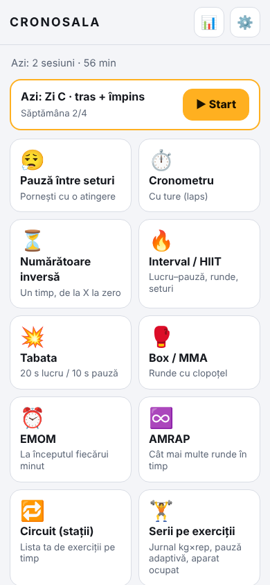
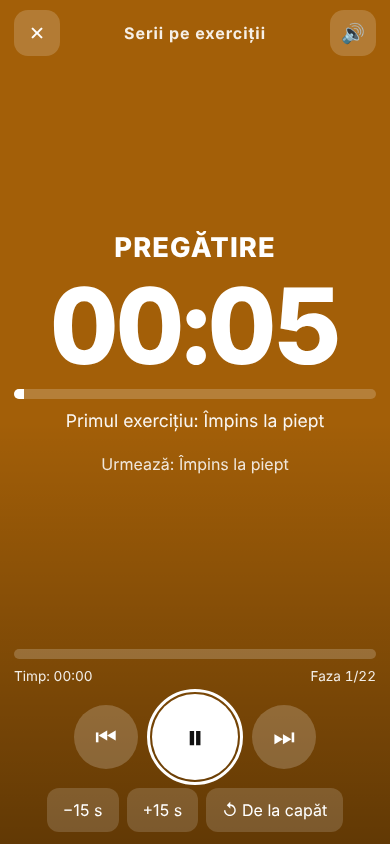
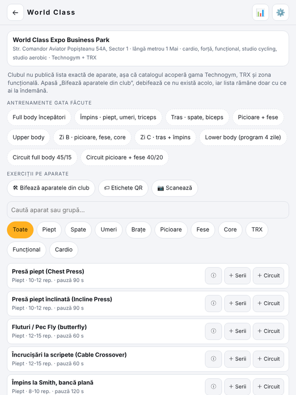
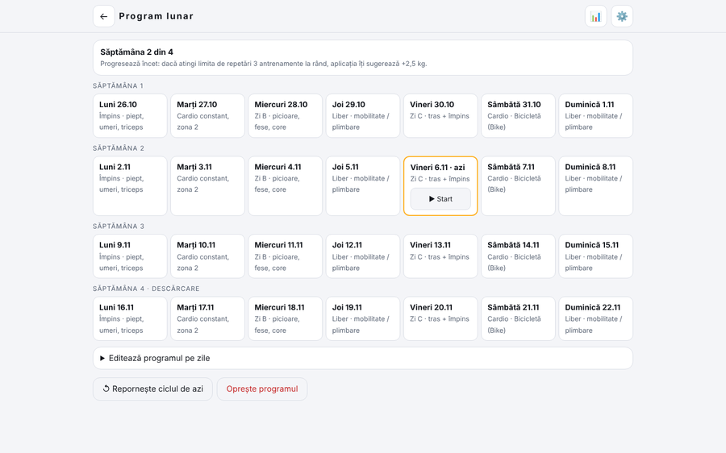

# CRONOSALA ⏱️

**Cronometre și jurnal de antrenament pentru sală — un singur fișier HTML, offline, fără conturi, fără urmărire.**
*A single-file, offline, trade-free gym timer and training log (Romanian UI).*

Deschide [`index.html`](index.html) în orice browser modern (sau pagina publicată cu GitHub Pages) și adaug-o pe ecranul principal. Nu are dependențe, nu face cereri de rețea (politica CSP le interzice) și își ține datele doar în `localStorage`.

| Telefon | Telefon (în antrenament) | Tabletă |
|---|---|---|
|  |  |  |



## Ce conține

**Cronometre:** pauză între seturi, cronometru cu ture, numărătoare inversă, Interval/HIIT, Tabata, Box/MMA, EMOM, AMRAP (cu contor), circuit pe stații, serii pe exerciții, tempo la repetări, izometric, piramidă, metronom (cu tap tempo) și **antrenament în doi**.

**Sala World Class Expo Business Park (lângă metrou 1 Mai):** catalog cu 67 de exerciții (gama Technogym, TRX, zonă funcțională) și 11 variante de cardio, 10 antrenamente gata făcute, bifare a aparatelor care există efectiv în club. *Clubul nu publică lista exactă de aparate; catalogul e orientativ.*

**Antrenament inteligent (fără cloud):**
- **Jurnal kg × repetări** la fiecare serie, precompletat cu ultima dată, cu recorduri personale și statistici (zile la rând, serii pe grupă în 7 zile, volum).
- **Pauză adaptivă:** +30 s după o serie sub limita de repetări și învață din ajustările tale de ±15 s, pe fiecare exercițiu.
- **Progresie dublă:** după 3 sesiuni la limita de repetări sugerează +2,5 kg.
- **Program lunar** în ciclu de 4 săptămâni (a patra = descărcare: 2 serii, ~90% din greutate), editabil pe zile, cu „Azi” pe ecranul principal.
- **Aparat ocupat:** alternative echivalente din catalog sau mutarea exercițiului la sfârșit.
- **Ghid pe aparat** (cum se face, greșeli frecvente), încălzire și răcire ghidate.

**Cod QR, fără server:** etichete QR de printat pentru aparate, scanner cu camera (`BarcodeDetector`, Chrome Android; altfel cod manual), partajare de timere prin cod QR / link. Generatorul QR e inclus în fișier (nivel L, versiunile 1–10).

**Sunet și voce:** bipuri programate pe ceasul audio, teme (clopoțel, fluier, blând, doar voce), voce în română („încă zece secunde”, numărătoare 3-2-1, nume de exerciții, numărarea repetărilor), vibrații, ecran aprins (Wake Lock), notificări la schimbarea fazei, reluare după reîncărcare.

**Date:** export/import complet (JSON), CSV pentru greutăți și sesiuni, ștergere totală.

## Interfață

Optimizată pentru telefon (portret și landscape, inclusiv ecrane de 320×568 și 568×320), tabletă și desktop: configurare pe două coloane, calendar pe 7 coloane, catalog pe două coloane, scurtături de tastatură în antrenament (`Spațiu` pauză, `←` `→` faze, `Enter` „Gata”, `+` `−` ±15 s, `Esc` închide), teme întunecată/luminoasă și `prefers-reduced-motion`.

## Limite cunoscute

- Cu ecranul blocat, unele browsere (mai ales iOS) pot opri sunetul sau notificările; ceasul rulează într-un Web Worker și sunetul „playback” ajută, dar nu garantează. Ține ecranul aprins în antrenament (opțiune activă implicit).
- Un widget pe ecranul blocat nu se poate face într-un singur fișier HTML.
- Scanarea cu camera depinde de `BarcodeDetector` (Chrome/Android). Pe celelalte browsere folosește codul scris sub etichetă (ex. `E12`).
- Vocea depinde de vocile instalate pe dispozitiv.
- Linkurile de partajare funcționează doar dacă fișierul e găzduit; codul `CS:T…` merge oricum la „Importă timer”.

## Dezvoltare

Totul e în `index.html` (HTML + CSS + JS, fără build). Testele (167 de verificări în Chrome real) sunt în [`tests/`](tests/README.md):

```bash
npm install && npm test
```

## Licență

[MIT](LICENSE) © 2026 Alexio. Aplicație în spiritul mișcării *trade-free*: fără reclame, fără urmărire, fără cont.
